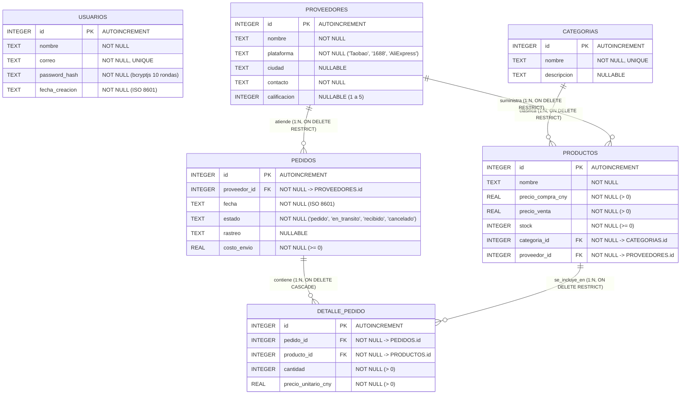

# Entregables del Proyecto: Ichigo Kitty (Kitty Import)

---

## 1. Informe de Investigación a Profundidad: Aplicación de Tokens JWT y Seguridad en APIs REST

### 1.1 Introducción a la Autenticación Basada en Tokens (Stateless)
En las arquitecturas cliente-servidor modernas (como una SPA en React consumiendo una API REST en Express), la autenticación tradicional basada en sesiones del servidor obliga a almacenar el estado de cada usuario conectado en memoria o base de datos. Frente a ello, el estándar **JSON Web Token (JWT, RFC 7519)** permite implementar un mecanismo **sin estado (*stateless*)**: el servidor valida las credenciales una sola vez en el inicio de sesión y emite un token firmado criptográficamente. En cada petición subsecuente, el cliente envía dicho token y el servidor verifica su autenticidad y vigencia matemáticamente usando su clave secreta, sin necesidad de consultar una tabla de sesiones.

### 1.2 Estructura Interna de un JSON Web Token (JWT)
Un JWT es una cadena compacta codificada en **Base64Url** dividida en tres partes separadas por puntos (`Header.Payload.Signature`):

1. **Header (Encabezado)**:
   Especifica el tipo de token (`"typ": "JWT"`) y el algoritmo criptográfico empleado para la firma, en este proyecto `HS256` (HMAC con SHA-256):
   ```json
   {
     "alg": "HS256",
     "typ": "JWT"
   }
   ```
2. **Payload (Carga útil o *Claims*)**:
   Contiene las declaraciones (*claims*) sobre la entidad autenticada y metadatos de control como `iat` (*issued at*, instante de emisión) y `exp` (*expiration time*, instante de vencimiento).
   - **Principio de minimización de datos**: Como el *payload* únicamente está codificado en Base64Url y **no cifrado**, cualquier persona que intercepte el token puede decodificar su contenido. Por ello, en **Ichigo Kitty** el *payload* almacena exclusivamente el identificador del usuario (`{ "id": usuario.id }`), omitiendo correos electrónicos, nombres o hashes de contraseñas.
3. **Signature (Firma criptográfica)**:
   Se calcula combinando el *Header* y el *Payload* codificados en Base64Url y firmándolos mediante el algoritmo `HMAC-SHA256` junto con la clave secreta almacenada en la variable de entorno `JWT_SECRET`:
   $$\text{Signature} = \text{HMAC-SHA256}(\text{base64UrlEncode}(\text{Header}) + \text{"."} + \text{base64UrlEncode}(\text{Payload}), \text{JWT\_SECRET})$$
   Si un atacante modifica un solo carácter del *payload* (por ejemplo, cambiar `"id": 2` por `"id": 1`), la firma resultante no coincidirá con la calculada por el servidor y el middleware rechazará el token inmediatamente con `401 Unauthorized`.

### 1.3 Protección de Contraseñas con `bcryptjs`
Antes de emitir cualquier token, la base de datos debe resguardar las credenciales de forma irreversible. Guardar contraseñas en texto plano o con funciones hash rápidas (como MD5 o SHA-256) expone a los usuarios ante ataques de diccionario y tablas arcoíris (*rainbow tables*).
- **Algoritmo Bcrypt y Factor de Costo**: En el registro (`POST /api/auth/register`), se utiliza `bcryptjs` con **10 rondas de costo** (` saltRounds = 10`, equivalente a $2^{10} = 1024$ iteraciones internas del cifrado Blowfish).
- **Sal aleatoria integrada (*Salt*)**: `bcryptjs` genera automáticamente una sal aleatoria única por cada usuario y la incorpora en la misma cadena resultante (`password_hash`). Así, dos usuarios con la misma contraseña producen hashes completamente distintos.
- **Mitigación de enumeración de usuarios**: En el inicio de sesión (`POST /api/auth/login`), tanto si el correo no existe en SQLite como si la contraseña no coincide al evaluarla con `bcrypt.compareSync`, el servidor devuelve exactamente el mismo código y mensaje (`401 {"error": "Correo o contraseña incorrectos"}`), impidiendo que un atacante descubra qué correos están registrados.

### 1.4 Aplicación Práctica del Token en el Proyecto (Backend y Frontend)

1. **Emisión y Configuración Segura (`.env`)**:
   - Al autenticar al usuario en [authController.js](backend/src/controllers/authController.js), el servidor firma el token con `jwt.sign({ id: registroUsuario.id }, process.env.JWT_SECRET, { expiresIn: process.env.JWT_EXPIRA })`.
   - La clave `JWT_SECRET` (de al menos 48 caracteres de entropía) y el tiempo de vida `JWT_EXPIRA=8h` se cargan desde `backend/.env` mediante `dotenv`, quedando excluidos del control de versiones a través de `.gitignore`.

2. **Transporte mediante Esquema `Bearer` (RFC 6750)**:
   - El cliente envía el token en cada petición a rutas protegidas dentro del encabezado estándar HTTP:
     ```http
     Authorization: Bearer <token>
     ```

3. **Verificación en el Middleware ([authMiddleware.js](backend/src/middlewares/authMiddleware.js))**:
   - El middleware intercepta todas las rutas de `/api/proveedores`, `/api/categorias`, `/api/productos`, `/api/pedidos`, `/api/detalle_pedido` y `/api/auth/me` directamente en [app.js](backend/src/app.js).
   - Comprueba la presencia del prefijo `Bearer `, extrae el token y ejecuta `jwt.verify(token, process.env.JWT_SECRET)`. Si el token falta, está truncado, fue firmado con otra clave o superó las 8 horas de vigencia (`TokenExpiredError`), responde `401 {"error": "No autorizado"}`. Si es válido, inyecta `req.usuarioId = payload.id` y cede el control al controlador.

4. **Gestión en el Cliente React ([AuthContext.jsx](frontend/src/context/AuthContext.jsx) y [api.js](frontend/src/services/api.js))**:
   - El token se persiste en `localStorage` bajo la clave `"token_kitty"`.
   - Un **interceptor de petición de Axios** adjunta automáticamente el encabezado `Authorization: Bearer <token>` antes de despachar cualquier solicitud HTTP.
   - Al recargar la aplicación, `AuthContext` invoca `GET /api/auth/me` para reconstruir el estado del usuario a partir del token guardado.
   - Un **interceptor de respuesta de Axios** detecta cualquier respuesta `401` fuera de `/auth/login` y `/auth/register`, elimina `"token_kitty"` de `localStorage` y redirige de inmediato a `/login`.

### 1.5 Fuentes Consultadas
1. **IETF — RFC 7519**: Jones, M., Bradley, J., & Sakimura, N. (2015). *JSON Web Token (JWT)*. Internet Engineering Task Force (IETF). Disponible en: https://datatracker.ietf.org/doc/html/rfc7519
2. **IETF — RFC 6750**: Jones, M., & Hardt, D. (2012). *The OAuth 2.0 Authorization Framework: Bearer Token Usage*. Internet Engineering Task Force (IETF). Disponible en: https://datatracker.ietf.org/doc/html/rfc6750
3. **OWASP Foundation**: *JSON Web Token (JWT) Cheat Sheet for Java / Web Applications* & *Password Storage Cheat Sheet*. Open Worldwide Application Security Project. Disponible en: https://cheatsheetseries.owasp.org/cheatsheets/JSON_Web_Token_for_Java_Cheat_Sheet.html y https://cheatsheetseries.owasp.org/cheatsheets/Password_Storage_Cheat_Sheet.html
4. **Auth0 Documentation**: *Introduction to JSON Web Tokens*. Auth0 by Okta. Disponible en: https://jwt.io/introduction
5. **MDN Web Docs**: *HTTP Authentication — Bearer tokens & Authorization header*. Mozilla Developer Network. Disponible en: https://developer.mozilla.org/es/docs/Web/HTTP/Authentication
6. **Documentación Oficial de `jsonwebtoken` (Node.js)**: Auth0 / npm. Disponible en: https://github.com/auth0/node-jsonwebtoken

---

## 2. Diagrama Entidad-Relación (ER) Actualizado

El modelo de base de datos en SQLite (`kitty_import.db`) consta de **6 entidades**: las 5 entidades operativas del negocio (`PROVEEDORES`, `CATEGORIAS`, `PRODUCTOS`, `PEDIDOS`, `DETALLE_PEDIDO`) con integridad referencial activa (`PRAGMA foreign_keys = ON`) y la entidad `USUARIOS` encargada del control de acceso mediante JWT.



### Resumen de Relaciones y Reglas de Integridad
| Relación | Cardinalidad | Clave Foránea | Regla de Eliminación / Negocio |
| :--- | :---: | :--- | :--- |
| `CATEGORIAS` -> `PRODUCTOS` | `1 : N` | `productos.categoria_id` | No permite borrar categoría con productos asociados (`409 Conflict`). |
| `PROVEEDORES` -> `PRODUCTOS` | `1 : N` | `productos.proveedor_id` | No permite borrar proveedor con productos asociados (`409 Conflict`). |
| `PROVEEDORES` -> `PEDIDOS` | `1 : N` | `pedidos.proveedor_id` | No permite borrar proveedor con pedidos asociados (`409 Conflict`). |
| `PEDIDOS` -> `DETALLE_PEDIDO` | `1 : N` | `detalle_pedido.pedido_id` | Al recibir un pedido (`estado = 'recibido'`), suma `cantidad` al `stock` de cada producto en una transacción. |
| `PRODUCTOS` -> `DETALLE_PEDIDO` | `1 : N` | `detalle_pedido.producto_id` | No permite borrar producto con detalles de pedido asociados (`409 Conflict`). |
| `USUARIOS` (Autenticación) | Independiente | — | Protege todos los endpoints de las 5 entidades mediante `authMiddleware` (`JWT`). |
